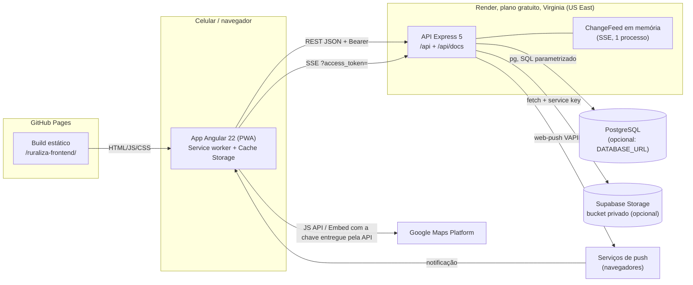
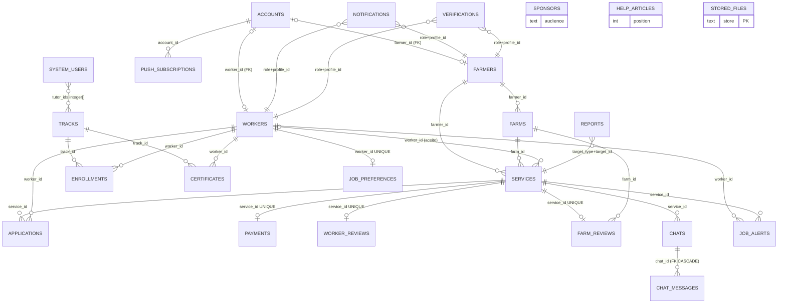
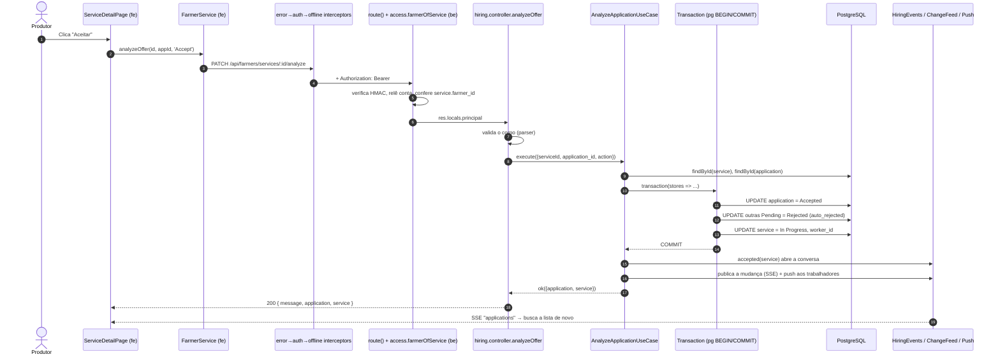

# Análise técnica do Ruraliza

Base para a apresentação técnica, o roteiro e o FAQ de treino. Levantada só por leitura do código em 18/11/2026, nos commits `9f9651d` (backend) e `4eedb07` (frontend).

**Como ler:**

- `be/` é `ruraliza-backend/` e `fe/` é `ruraliza-frontend/`. As citações seguem o formato `repo/caminho:linha`.
- **[A CONFIRMAR]** marca o que o código não prova, com o motivo.
- **Implementado** quer dizer que existe em código e tem teste ou rota. **Planejado** quer dizer que só aparece em TODO, documento ou lista de próximos passos.

**Evidências rodadas nesta análise (18/11/2026), depois das respostas da equipe:**

- `npm test` no backend passou: tipos, lint (1 aviso), regras, 284 unitários, 60 de integração e setup, 551 verificações e2e.
- `npm run check:contracts` passou.
- `ng test --watch=false` no frontend passou: 61 arquivos, 225 testes.
- O documento OpenAPI foi gerado de `createApi()` para contar as rotas: 141 operações.
- `npm run test:postgres` passou sobre o PostgreSQL local: 74 testes (persistência, integração e setup) e as 551 verificações e2e.
- No frontend, `npm run lint`, `check:rules`, `typecheck` e `ng build` passaram. O bundle inicial tem 417 kB (118 kB transferidos) e 4 rotas são pré-renderizadas.
- Cobertura do backend com a cobertura nativa do Node (`--experimental-test-coverage`), contando unitários, integração, setup, PostgreSQL e e2e: **97,0% das linhas, 85,5% dos desvios e 83,4% das funções**. Só com a memória (sem `tests/postgres`), 95,3%, 84,8% e 80,3%.
- Cobertura do frontend com `ng test --coverage` e o `@vitest/coverage-v8` 5.0.2 instalado só nesta máquina (`--no-save`): **79,3% das linhas, 77,0% dos desvios e 72,4% das funções**. O número vale só para os 80 arquivos que os testes importam, de 250 arquivos de código.
- O contraste dos tokens passou a ser conferido por `npm run check:contrast` no frontend (ver §5.3).

**Respostas da equipe (18/11/2026)** fecharam os itens [A CONFIRMAR] sobre o Render, os contribuidores, o SSR e o documento ausente. Elas estão marcadas como "informado pela equipe".

---

## 1. Resumo executivo

- **O que é:** um marketplace AgTech que liga produtores rurais a trabalhadores, prestadores e estudantes para serviços operacionais em fazendas (`be/PRODUCT.md:7`).
- **Para quem:**
  - o produtor, que cadastra fazendas, publica vagas, contrata, paga (simulado) e avalia;
  - o trabalhador, que busca vagas, se candidata, conversa, estuda trilhas e recebe certificados;
  - a equipe interna, com os cargos `admin` e `tutor` (`be/PRODUCT.md:11-14`).
- **Problema que resolve:** cobrir o ciclo inteiro de uma contratação no campo, da vaga à avaliação. Também cobre formação (trilhas com certificado) e confiança (verificação de identidade, denúncias, avaliação dupla e cega) (`be/PRODUCT.md:7`, `:20-28`).
- **Forma:** uma API REST em Node/Express/TypeScript e um PWA em Angular 22, pensado para o celular e para sinal fraco, com modo sem internet (`fe/PRODUCT.md:31`).
- **Estado atual:** demonstração. O seed de contas de teste sobe também em produção por padrão (`be/src/shared/config.ts:99-101`), o pagamento é simulado e não existe envio de e-mail (`be/PRODUCT.md:24`, `:37`).

## 2. Arquitetura geral

### Componentes

| Componente | O que é | Onde |
|---|---|---|
| Frontend (PWA) | Angular 22 standalone. O build gera o servidor SSR, mas o SSR **não é usado** (informado pela equipe): o deploy publica só os arquivos estáticos no GitHub Pages | `fe/.github/workflows/deploy.yml:39-54`, `fe/docs/architecture.md:82` |
| Backend (API) | Express 5 sob o prefixo `/api`, com OpenAPI em `/api/docs` | `be/app.ts:36-83` |
| Banco | PostgreSQL quando há `DATABASE_URL`; sem ela, memória | `be/app.ts:157-176`, `be/src/shared/config.ts:12-14` |
| Arquivos | Tabela `stored_files` (bytea) ou bucket privado do Supabase Storage | `be/src/migrations/001-initial.ts:327-334`, `be/src/shared/infra/supabase/supabase-file-store.ts:61` |
| Google Maps | A chave sai da API para o navegador, só para origens permitidas | `be/src/modules/platform/presentation/platform.routes.ts:15-17` |
| Web Push | `web-push` com chaves VAPID | `be/src/modules/notifications/infra/web-push-sender.ts:28` |
| Tempo real | SSE (`text/event-stream`), com eventos sem dados | `be/src/shared/infra/http/sse.ts:21-41` |

**Como se comunicam:**

- O app faz chamadas REST com JSON e `Authorization: Bearer` para `environment.apiUrl` (`fe/src/environments/environment.ts:3`).
- O tempo real chega por `EventSource`, com o token em `?access_token=` (`fe/src/app/core/api/live-updates.service.ts:88`).
- Fotos e PDFs vão como corpo binário (`image/*` ou `application/pdf`) (`be/app.ts:52-54`).

## 3. Stack

Versões de `package.json`, em faixas. O backend não versiona o lockfile (`be/.gitignore:4`). O frontend versiona.

### Backend (`be/package.json`)

| Tecnologia | Versão | Uso | Justificativa aparente |
|---|---|---|---|
| Node.js | 24 no CI (`be/.github/workflows/ci.yml:35`); o README aceita 20.19+ (`be/README.md:17`) | Runtime | Sem `engines` no `package.json` |
| TypeScript | ^6.0.3 | Linguagem, com o modo estrito ampliado (`be/tsconfig.json:15-27`) | Segurança de tipos de ponta a ponta |
| Express | ^5.2.1 | HTTP | O Express 5 repassa as promises rejeitadas ao handler de erro (`be/app.ts:100-101`) |
| pg | ^8.23.0 | Driver PostgreSQL, sem ORM | Repositório genérico por igualdade de campos (`be/docs/architecture.md:100`) |
| sequelize | ^6.37.8 | **Instalado e sem uso** | Sobra; traz 2 avisos moderados do `uuid` (`be/docs/quality.md:41`) |
| sharp | ^0.35.5 | Foto vira WebP de até 1000 px, sem EXIF | Reduz o tamanho e tira o GPS (`be/README.md:84`) |
| web-push | ^3.6.7 | Notificações push | Padrão Web Push com VAPID |
| swagger-ui-express | ^5.0.1 | Documentação interativa | O OpenAPI sai das próprias rotas |
| cors, dotenv | ^2.8.6, ^18.0.4 | CORS e `.env` | — |
| tsx | ^4.23.15 | Execução e testes em dev | Roda TS sem passo de build |
| node:test + ajv | nativo, ^8.20 | Testes; respostas conferidas contra o OpenAPI | Sem framework de teste extra |
| ESLint + typescript-eslint | ^10.11, ^8.70 | `strictTypeChecked` mais as regras locais | Proíbe `any` e promessa solta (`be/docs/quality.md:24`) |

### Frontend (`fe/package.json`)

| Tecnologia | Versão | Uso | Justificativa aparente |
|---|---|---|---|
| Angular (core, router, forms, ssr, service-worker) | ^22.2.0 | SPA standalone com signals, SSR e prerender | Bundle inicial pequeno com features lazy (`fe/docs/architecture.md:88`) |
| @angular/google-maps | ^22.2.1 | Mapa da fazenda | A chave vem do backend |
| RxJS | ~7.8.0 | HttpClient e streams | Padrão do Angular |
| Express + compression | ^5.1.0, ^1.8.2 | Servidor SSR (`fe/src/server.ts`) | **Não é usado no deploy** (`fe/docs/architecture.md:82`) |
| TypeScript | ~6.0.2 | Linguagem | — |
| Vitest + jsdom | ^5.0.0, ^30 | Testes via `ng test` | Builder `@angular/build:unit-test` |
| ESLint + angular-eslint | ^10.13, ^22.6 | Lint de TS e templates, inclusive acessibilidade | `fe/eslint.config.mjs:57-60` |
| Prettier | ^3.8.1 | Instalado, **sem script** | Cerca de 340 arquivos fora do padrão (`fe/docs/quality.md:47`) |
| CSS puro com tokens | — | Sistema visual próprio | Marca própria e temas por atributo (`fe/docs/architecture.md:93`) |

## 4. Backend

### 4.1 Organização do código

- **Fatias por contexto:** 22 módulos em `src/modules/` (`be/docs/architecture.md:34-36`). São eles: accounts, admin, auth, chat, farm-stats, farmers, farms, help, hiring, live, matching, media, notifications, platform, reports, reviews, services, sponsors, system-users, tracks, verification e workers.
- **Camadas:** `presentation -> application -> domain <- infra` (`be/docs/architecture.md:57`).
  - `domain/` guarda as portas e as regras puras.
  - `application/` tem um `*.usecase.ts` por caso de uso.
  - `infra/` tem o repositório em memória, o repositório `pg-*` e os adaptadores.
  - `presentation/` tem controller, rotas, parsers e schemas OpenAPI.
- **Padrões de projeto:**
  - **Portas e adaptadores.** `Repository<T,K>` é a porta (`be/src/shared/domain/repository.ts`); `InMemoryRepository` e `PgRepository` são as implementações.
  - **Raiz de composição.** `src/container.ts` liga as implementações aos casos de uso.
  - **Result em vez de exceção.** Os casos de uso devolvem `ok`, `invalid`, `unauthorized`, `forbidden`, `not_found` ou `conflict`. `sendFailure` traduz o resultado em status HTTP (`be/src/shared/infra/http/respond.ts:16`).
  - **Unit of Work.** A porta `Transaction<R>` (`be/src/shared/domain/transaction.ts:4`) é usada na contratação (`be/src/modules/hiring/application/analyze-application.usecase.ts:54`).
  - **Fronteira entre módulos.** Os imports cruzam só por `#modules/<módulo>`, a entrada pública de cada módulo (`be/package.json`, campo `imports`). Para quebrar ciclos, o container liga portas como `ProfileFactory` e `ProfileCleanup` (`be/docs/architecture.md:59`).
  - **Rota declarativa.** `route(método, caminho, handler, doc, access)` junta o handler, a regra de acesso e o OpenAPI (`be/src/shared/infra/http/route.ts:25-74`).
- **Observação:** o README chama a estrutura de "MVC" (`be/README.md:5`), mas o próprio documento de arquitetura corrige que ela é de portas e casos de uso (`be/docs/architecture.md:59`).

### 4.2 Modelo de dados

- O esquema está numa única migração, `001-initial`, com 24 tabelas: 23 repositórios mais `stored_files`. A tabela `schema_migrations` é criada pelo migrador (`be/src/migrations/001-initial.ts:17-334`, `be/src/shared/infra/postgres/migrate.ts:19-20`).
- **Integridade:**
  - Só duas chaves estrangeiras: `accounts.farmer_id/worker_id`, com `ON DELETE SET NULL` (`:49-50`), e `chat_messages.chat_id`, com `ON DELETE CASCADE` (`:176`).
  - As outras relações são **lógicas** e a limpeza fica nos casos de uso (`ProfileCleanup`).
  - As regras de "um só" viram `UNIQUE`, por exemplo uma candidatura aceita por serviço (`:112`) e um pagamento por serviço (`:116`).
- **Tipos:**
  - `id integer` identity; `timestamptz` para instantes e `date` para prazos.
  - `jsonb` para `farm.photos`, `tracks.modules` e `preferences`.
  - **Dinheiro em `double precision`** (`services.price` `:91`, `payments.value` `:119`).

Fora as duas chaves estrangeiras marcadas, as ligações do diagrama são lógicas: não há restrição no banco.

### 4.3 API

São 141 operações, geradas do documento OpenAPI montado por `createApi()` (`be/src/routes.ts:29-106`). Por público:

- 16 públicas;
- 85 de conta do app, com conferência do dono;
- 40 da equipe, com conferência de permissão.

A tabela agrupa as rotas pelo prefixo. A lista completa, com o resumo de cada uma, está em `/api/docs`.

| Método | Rota | Propósito | Autenticação |
|---|---|---|---|
| POST | `/api/auth/login` | Login da conta | Pública |
| POST | `/api/auth/password-reset`, `/confirm` | Esqueci a senha | Pública (desligada fora do `--dev`) |
| POST | `/api/auth/system/login` | Login da equipe | Pública |
| GET/PATCH | `/api/auth/system/me` | Sessão e perfil da equipe | Qualquer usuário de sistema |
| GET | `/api/accounts/{id}` | Sessão da conta | A própria conta |
| POST/PATCH/GET | `/api/accounts/{id}/profiles`, `/active-role`, `/preferences` | Segundo perfil, troca de painel, preferências | A própria conta |
| POST/DELETE | `/api/accounts/{id}/push-subscriptions` | Liga e desliga o push | A própria conta |
| POST | `/api/farmers`, `/api/workers` | Cadastro | Pública |
| GET | `/api/farmers`, `/api/workers` | Listagem | Equipe `users:manage` |
| GET/PATCH/DELETE | `/api/farmers/{id}`, `/api/workers/{id}` | Perfil | O próprio perfil |
| PATCH | `/api/{farmers,workers}/{id}/password` | Troca de senha | O próprio perfil |
| POST/DELETE | `/api/{farmers,workers}/{id}/photo`, `/api/workers/{id}/resume` | Foto e currículo | O próprio perfil |
| CRUD | `/api/farmers/{id}/farms[/{farmId}[/photos/{photoId}]]` | Fazendas e fotos | O próprio produtor |
| POST | `/api/farmers/services` | Publica a vaga (RF01) | Produtor, com `farmer_id` do corpo igual ao dele |
| GET/PATCH | `/api/farmers/services/{id}`, `/cancel` | Detalhe, edição, cancelamento | O produtor dono do serviço |
| GET | `/api/farmers/services/{id}/applications`, `/events` (SSE) | Candidaturas | O produtor dono do serviço |
| PATCH | `/api/farmers/services/{id}/analyze` | Aceita ou recusa (RF03) | O produtor dono do serviço |
| POST | `/api/farmers/services/{id}/payment` | Libera o pagamento simulado (RF04) | O produtor dono do serviço |
| GET/POST | `/api/{farmers,workers}/services/{id}/review[s]` | Avaliações | O dono do serviço ou o trabalhador |
| GET | `/api/workers/services[/{id}]` | Busca e detalhe de vaga (RF02) | Trabalhador |
| POST/PATCH | `/api/workers/services/{id}/apply`, `/withdraw` | Candidatura e desistência | Trabalhador, com `worker_id` igual ao dele |
| GET/PUT | `/api/workers/{id}/job-preferences`, `/recommended-jobs` | Vagas para você | O próprio trabalhador |
| GET/POST/PUT/DELETE | `/api/workers/tracks…`, `/api/workers/{id}/tracks/{trackId}/lessons/{lessonId}/completion`, `/certificates` | Trilhas, aulas, certificados | Trabalhador |
| GET | `/api/{farmers,workers}/{id}/chats[/events]`, `/live`, `/notifications[/events]` | Conversas, stream único, central de avisos | O próprio perfil |
| GET/POST/PATCH | `/api/chats/{id}`, `/events`, `/messages`, `/read`, `/phone` | Conversa e WhatsApp com consentimento | Participante da conversa |
| POST/GET | `/api/{farmers,workers}/{id}/reports`, `/verification` | Denúncia e verificação de identidade | O próprio perfil |
| GET | `/api/reviews/workers/{id}`, `/farms/{id}` | Reputação | Qualquer conta do app |
| GET | `/api/farmers/{id}/stats` | Painel da fazenda | O próprio produtor |
| * | `/api/admin/users…`, `/farmers/{id}`, `/workers/{id}` | Gestão de contas | Equipe `users:manage` |
| * | `/api/admin/system-users…` | Gestão da equipe | Equipe `system-users:manage` |
| * | `/api/admin/tracks…` | Editor de trilhas | Equipe `tracks:manage` ou `tracks:oversee` |
| * | `/api/admin/help…`, `/api/admin/sponsors…` | Conteúdo | Equipe `content:manage` |
| * | `/api/admin/reports…`, `/api/admin/verifications…` | Moderação | Equipe `moderation:manage` |
| GET/POST | `/api/help`, `/api/sponsors/slot`, `/api/sponsors/{id}/click` | Ajuda e patrocínio | Pública |
| GET | `/api/images/{id}`, `/api/documents/{id}` | Bytes da foto e do PDF | **Pública** (o id é um UUID) |
| GET | `/api/categories`, `/api/certificates/{code}`, `/api/health` | Catálogo, validação de certificado, saúde | Pública |
| GET | `/api/config/maps`, `/api/config/push` | Chave do mapa (exige `Origin` permitida) e chave VAPID pública | Pública |

### 4.4 Autenticação e autorização

**Conta do app:**

1. `POST /api/auth/login` responde com a mesma mensagem para e-mail desconhecido e para senha errada (`be/src/modules/auth/application/login.usecase.ts:11-20`).
2. A senha é guardada com **scrypt**: sal de 16 bytes, chave de 64 bytes, comparação com `timingSafeEqual` (`be/src/shared/infra/crypto/node-crypto.ts:15-29`).
3. O token é próprio, `<payload base64url>.<HMAC-SHA256>`, com `{kind,id,exp}` e validade de **12 h**. Não guarda estado no servidor (`be/src/shared/infra/crypto/node-crypto.ts:44-69`, `be/src/shared/domain/tokens.ts:7`). Não é um JWT padrão.
4. Sem `AUTH_TOKEN_SECRET`, o servidor gera um segredo aleatório por processo e as sessões caem no reinício (`be/src/shared/config.ts:83-93`).

**Em cada requisição:**

1. `route()` chama `access.authorize(req)` antes do handler (`be/src/shared/infra/http/route.ts:38-48`).
2. `authenticate` relê a conta ou o usuário de sistema no repositório, então um perfil removido perde o acesso na hora (`be/src/modules/auth/presentation/access.ts:64-76`).
3. As políticas conferem o dono do recurso:
   - pelo parâmetro da URL: `ownFarmer`, `ownWorker`, `ownAccount`;
   - pelo corpo ou pela query: `farmerInBody`, `workerInBody`, `worker`;
   - pelo recurso: `farmerOfService`, `chatParticipant` (`be/src/modules/auth/presentation/access.ts:100-158`).
4. As respostas:
   - **401** para token ausente ou inválido, com `WWW-Authenticate: Bearer realm="ruraliza"` para o app distinguir sessão vencida de senha errada (`be/src/shared/infra/http/route.ts:41-42`);
   - **403** para um recurso de outro dono.

**Equipe:**

- Tem login próprio e acesso por **permissão**, não por cargo.
- O mapa `SYSTEM_PERMISSIONS` dá ao admin 5 permissões e ao tutor só `tracks:manage` (`be/src/modules/system-users/domain/system-user.ts:15-34`).
- A rota declara a permissão com `access.system('...')` (`be/src/modules/auth/presentation/access.ts:161-175`).

**Redefinição de senha:**

- O token tem 32 bytes aleatórios e só o SHA-256 dele fica guardado, com validade de 30 min (`be/src/shared/infra/crypto/node-crypto.ts:32-42`, `be/README.md:86`).
- **Em produção não há entrega:** sem e-mail, nada é criado (`be/src/modules/auth/application/request-password-reset.usecase.ts:16-22`).
- No `--dev`, o código sai no terminal (`be/app.ts:189-191`).

### 4.5 Validação, erros e logs

**Validação:**

- `req.body` e `req.query` chegam como `unknown` e passam por `isRecord` e `toBody` (`be/src/shared/infra/http/body.ts:4-10`) e pelos parsers de cada módulo (`presentation/*.parsers.ts`).
- Há regras de domínio no meio da validação:
  - filtro de palavrões, com normalização de acento e de troca de letra por número (`be/src/shared/domain/moderation.ts:9-40`);
  - ocultação de telefone e e-mail no chat (`be/src/modules/chat/domain/chat.rules.ts`);
  - vídeo das aulas só do YouTube ou do Vimeo (`be/src/modules/tracks/domain/video.ts:1-25`).

**Erros:**

- O formato é sempre `{ error }`, em português (`be/docs/design.md:9-11`).
- O handler global (`be/app.ts:103-128`) responde:
  - 400 para JSON inválido;
  - 413 para corpo grande;
  - 409 para `UNIQUE` violado (código `23505`);
  - 400 para valor que o banco não guarda;
  - 500 genérico para o resto, com o stack só no log.

**Logs:**

- Não há logger: só `console.*` (`be/docs/quality.md:28`).
- Não há log de acesso nem identificador de requisição.

### 4.6 Integrações externas

| Integração | Estado | Evidência |
|---|---|---|
| PostgreSQL | Implementada e opcional. As migrações rodam na subida, sob `pg_advisory_xact_lock` | `be/src/shared/infra/postgres/migrate.ts:19-20` |
| Supabase Storage | Implementada e opcional. O bucket é conferido na subida e recusado se for público | `be/app.ts:164-167`, `be/src/shared/config.ts:25-33` |
| Google Maps | A chave é entregue ao frontend, só com `Origin` permitida; sem a chave, 503 | `be/src/modules/platform/presentation/platform.routes.ts:15-17` |
| Web Push (VAPID) | Implementado. O envio acontece em segundo plano e a falha não derruba a resposta | `be/src/modules/notifications/application/push-dispatcher.ts:22-33`, `be/PRODUCT.md:66` |
| Resumo semanal de vagas | `setInterval` de 1 h no processo | `be/app.ts:198-201`, `be/src/modules/matching/application/job-alerts.ts:86` |
| E-mail | **Não existe** (`TODO(email)`) | `be/src/modules/auth/application/request-password-reset.usecase.ts:16` |
| Pagamento | **Simulado**, sem gateway | `be/PRODUCT.md:24` |
| WhatsApp | Os avisos por WhatsApp foram retirados (commit `975d5da`). Fica só o telefone liberado na conversa com consentimento dos dois | `git log`, `be/PRODUCT.md:23` |

## 5. Frontend

### 5.1 Estrutura, componentes e telas

- **Pastas** (`fe/docs/architecture.md:22-51`):
  - `core/` reúne api, http, layout, models, offline, pwa, session, preferences, maps e toast;
  - `shared/` tem `ui/` (18 componentes sem domínio), `domain/ui/` (cerca de 35 componentes de domínio) e `utils/`;
  - `features/` tem public, auth, account, farmer, worker e system.
  - Uma feature nunca importa outra; só o `app.routes.ts` importa features (`fe/docs/architecture.md:53`).
- **Componentes principais:**
  - de domínio: `service-card`, `chat-thread`, `review-form`, `farm-map`, `certificate-view`, `verification-card`, `notification-list` (`fe/src/app/shared/domain/ui/`);
  - cascas: `app-shell` (barra de cima, menu de baixo, sidebar) e `public-layout` (`fe/src/app/core/layout/`).
- **Rotas:** são 55 entradas de tela e 51 componentes de página (`*-page.ts`).

| Área | Rotas | Guard | Fonte |
|---|---|---|---|
| Pública | 13 rotas (`/`, `/cadastro`, `/entrar` e as de senha, `/conta/novo-perfil/:papel`, `/sistema/entrar`, `/certificados[/:code]`, `/creditos`, `/termos`, `/privacidade`, `/ajuda`) | `requireSignedIn` só em novo perfil | `fe/src/app/app.routes.ts:17-57` |
| Produtor `/produtor` | 13 (início, fazendas, serviços, detalhe, conversas, notificações, ajuda, perfil) | `requireRole('farmer')` | `fe/src/app/features/farmer/farmer.routes.ts:18-33` |
| Trabalhador `/trabalhador` | 16 (vagas, para você, candidaturas, conversas, trilhas, aulas, certificados…) | `requireRole('worker')` | `fe/src/app/features/worker/worker.routes.ts:22-41` |
| Sistema `/sistema` | 13 (usuários, equipe, trilhas, moderação, patrocínios, ajuda, perfil) | `requireSystemSignedIn` mais `requireSystemPermission` em cada rota | `fe/src/app/features/system/system.routes.ts:24-39` |

- **Renderização:**
  - Prerender em `/`, `/creditos`, `/termos` e `/privacidade`; o resto é `RenderMode.Client` (`fe/src/app/app.routes.server.ts:6-17`).
  - A hidratação tem replay de eventos e é incremental (`fe/src/app/app.config.ts:19`).

### 5.2 Estado e busca de dados

- **Não há biblioteca de estado** (NgRx ou similar). O estado vive em **Signals** dentro de serviços `providedIn: 'root'`. Exemplo: `CurrentUserService` (`fe/src/app/core/session/current-user.service.ts:19-28`).
- **Leituras:** `RemoteData<T>` modela os estados `loading`, `error` e `success`, com `load()` para tentar de novo, e `mergeStates` junta vários estados (`fe/src/app/shared/utils/remote-data.ts:5-30`).
- **Serviços HTTP:**
  - os que servem a 2+ features ficam em `core/api/`;
  - os de uma feature ficam em `features/*/data-access/`. Exemplo: `FarmerService.analyzeOffer` (`fe/src/app/features/farmer/data-access/farmer.service.ts:111-117`).
- **Tempo real:** um único `EventSource` por perfil é dividido entre o sino, as conversas e as candidaturas. O evento só diz "busque de novo" (`fe/docs/architecture.md:73`).
- **Modo sem internet:**
  - as respostas GET de prefixos escolhidos vão para o Cache Storage; streams e `/verification` nunca entram (`fe/src/app/core/offline/offline-cache.service.ts:11-12`);
  - há uma fila de ações idempotentes em `localStorage` (`fe/src/app/core/offline/offline-queue.service.ts:68`).

### 5.3 UI/UX

- **Biblioteca de componentes:** nenhuma. O CSS é próprio, com tokens em `fe/src/styles/tokens.css` e utilitários em `layout.css` (`fe/docs/design.md:13-28`).
- **Responsividade:**
  - celular primeiro, com menu de baixo de 3 a 5 itens, testado em `*-layout.spec.ts` (`fe/PRODUCT.md:32`, `:57`);
  - sidebar no desktop (`fe/docs/design.md:27`).
- **Acessibilidade** (`fe/docs/design.md:30-43`):
  - foco visível;
  - campos com 48 px de altura e 16 px de fonte;
  - alvos de toque de pelo menos 44 px;
  - estrelas de avaliação com rádios nativos;
  - toasts com `role=status/alert`;
  - `prefers-reduced-motion`;
  - temas escuro e de alto contraste e letras maiores (tudo em `rem`);
  - lint `templateAccessibility` (`fe/eslint.config.mjs:57-60`).
  - Contraste conferido por `npm run check:contrast` (`fe/scripts/check-contrast.mjs`), que também roda no `npm run verify` e no CI. O script lê `tokens.css` e calcula a razão da WCAG 2.x em 108 pares nos quatro temas: texto 4,5:1 e borda de campo 3:1 sobre o fundo e os cartões, texto 4,5:1 sobre botões e chips.
  - **Achado:** no tema claro, `--orange-700` (`#B86505`) dava 4,28:1 sobre o branco, embora o comentário do token prometesse AA. Ele é usado em texto pequeno (prazos, avisos da conversa, nota das estrelas). Passou a `#B06104` (4,61:1) (`fe/src/styles/tokens.css:26`). A mudança ainda não foi conferida no navegador.
  - O script não cobre contraste sobre fotos nem combinações fora dos pares listados.
- **i18n:** **não existe.** Só pt-BR (`<html lang="pt-BR">`, `fe/src/index.html:2`). A tradução está fora do escopo (`fe/PRODUCT.md:41`).
- **PWA:** `ngsw-config.json`, faixa de versão nova, botão de instalar e push (`fe/docs/architecture.md:76`).

## 6. Integração front ↔ back

### 6.1 Cliente HTTP e contratos

- `HttpClient` com `withFetch()` e três interceptors (`fe/src/app/app.config.ts:22`), do mais externo para o mais interno:
  1. `errorInterceptor` converte o erro em `ApiError` e mostra um toast, exceto com `SILENT_ERRORS` (`fe/src/app/core/http/error.interceptor.ts:13-25`);
  2. `authInterceptor` põe o Bearer: o token da equipe para `/admin` e `/auth/system/`, o da conta para o resto (`fe/src/app/core/http/auth.interceptor.ts:10-33`);
  3. `offlineCacheInterceptor`.
- **Contratos:**
  - Os tipos de `be/src/modules/*/*.contract.ts` têm de ser **idênticos** aos de `fe/src/app/core/models/*`.
  - Quem confere é `be/contract-check/frontend-parity.ts`, com `Equals<A,B>` estrito nos dois sentidos (`:28-35`).
  - A conferência roda em `npm run check:contracts`, que passou nesta análise.
  - Ela **fica fora do CI**, porque precisa do outro repositório (`be/docs/quality.md:20`).
  - A lista de palavrões também é conferida nos dois lados (`be/src/shared/domain/moderation.ts:2-3`).

### 6.2 Autenticação no cliente

- **Armazenamento:** o token e o usuário ficam em `sessionStorage` (`ruraliza.sessionToken`, `ruraliza.currentUser`) e valem só enquanto a aba está aberta (`fe/src/app/core/session/current-user.service.ts:12-13`, `:30-52`).
- **Renovação:** **não existe.** O token vale 12 h e depois disso é preciso entrar de novo. Não há refresh token.
- **Sessão vencida:** um 401 com `WWW-Authenticate: Bearer` limpa a sessão e leva a `/entrar` ou a `/sistema/entrar` (`fe/src/app/core/http/auth.interceptor.ts:18-47`).
- **Logout:**
  - `clear()` apaga o `sessionStorage` (`fe/src/app/core/session/current-user.service.ts:46-53`) e o cache offline também é apagado (`fe/docs/architecture.md:74`);
  - **o servidor não revoga** o token (`be/README.md:150`).
- **Guards:** só controlam a navegação. Quem protege os dados é a API (`fe/docs/architecture.md:94`).

### 6.3 Erros e carregamento

- `toApiError` usa a mensagem `{error}` da API ou um texto padrão por status. O status 0 vira "sem internet" ou "servidor inacessível" (`fe/src/app/core/http/api-error.ts:20-32`).
- Na tela, há `Skeleton`, `ProgressBar`, estados do `Button`, `ErrorState` e `EmptyState` (`fe/docs/design.md:42`).

### 6.4 Sequência: produtor aceita uma candidatura

Fontes:

- `fe/src/app/features/farmer/pages/service-detail-page.ts:216`;
- `fe/src/app/features/farmer/data-access/farmer.service.ts:111-117`;
- `be/src/modules/hiring/presentation/hiring.routes.ts:43`;
- `be/src/modules/hiring/presentation/hiring.controller.ts:38`;
- `be/src/modules/hiring/application/analyze-application.usecase.ts:35-80`;
- `be/src/shared/infra/postgres/database.ts:36-41`.

Se dois aceites chegam ao mesmo tempo, o índice único parcial `applications_one_accepted` barra o segundo e a API responde 409 (`be/src/migrations/001-initial.ts:112`, `be/app.ts:118-120`).

## 7. Qualidade

### 7.1 Testes

| Repositório | Tipo | Ferramenta | Quantidade (medida em 18/11/2026) | O que cobre |
|---|---|---|---|---|
| backend | Unitário | `node:test` + `tsx` | 77 arquivos `*.spec.ts`, **284 testes** | Casos de uso e regras com repositórios em memória |
| backend | Integração + setup | `node:test` | **60 testes** | Fluxos entre módulos pelo container, seed e boot (`be/tests/integration`, `be/tests/setup`) |
| backend | e2e | script próprio + `ajv` | **551 verificações** em `smoke.e2e.ts` (1496 linhas) | HTTP real, casos de erro, **todas as respostas conferidas contra o OpenAPI** (`be/tests/e2e/support/openapi-check.ts`) |
| backend | PostgreSQL | `node:test` | **74 testes** (`tests/postgres` + integração e setup repetidos) + as 551 verificações e2e sobre o banco | Persistência após reinício, paridade memória × banco, `UNIQUE` (`be/tests/postgres/postgres.test.ts`). Roda no CI |
| backend | Contrato | `tsc` | 1 verificação de tipos | Paridade com os models do frontend |
| frontend | Contraste | script Node, sem dependência | 108 pares em 4 temas | Cores de texto, bordas de campo e texto sobre preenchimento (`fe/scripts/check-contrast.mjs`) |
| frontend | Unitário e componente | Vitest + jsdom | 61 arquivos, **225 testes** | Interceptors, guards, sessão, fila offline, SSE, preferências, regras de prazo e de chat, layout do menu (`fe/PRODUCT.md:55-66`) |

**O que não está coberto:**

- No frontend não há e2e nem teste de navegador. Publicar em 2 passos, candidatar e aceitar, avaliação cega, filtros na URL e instalar o app são conferidos à mão (`fe/PRODUCT.md:68`).
- Não há teste de carga, de segurança automatizado nem de contraste.
- **Cobertura do backend** (medida em 18/11/2026, sem configuração no repositório): 97,0% das linhas, 85,5% dos desvios e 83,4% das funções, com todas as suítes. Os pontos com menos cobertura são `web-push-sender.ts` (57,5%, o envio real não é exercitado), `remove-sponsor-image.usecase.ts` (55,6%) e `reset-tokens.ts` (50%). Os `infra/pg-*.ts` só são cobertos pelo `test:postgres`.
- **Cobertura do frontend** (medida em 18/11/2026, com `@vitest/coverage-v8` instalado sem gravar no `package.json`): 79,3% das linhas, 77,0% dos desvios e 72,4% das funções. O relatório só conta os 80 arquivos que algum teste importa, de 250 arquivos de código em `src/app`: as páginas sem spec ficam fora da conta, então a cobertura real do app é menor. Entre os arquivos contados, as cascas (`app-shell.ts` 5%, `shell-topbar.ts` 4%, `farmer-layout.ts` e `worker-layout.ts` 25%), `help-center.ts` (14%), `empty-state.ts`, `error-state.ts` e `chat.service.ts` (20%) têm menos cobertura.
- Para repetir a medição, o pacote precisa entrar em `devDependencies`. Para contar também os arquivos sem teste, é preciso configurar `coverage.include`.
- O e2e do backend roda sobre a memória no `npm test` e sobre o PostgreSQL no `test:postgres`.

### 7.2 Lint, formatação, hooks e CI/CD

| Item | Backend | Frontend |
|---|---|---|
| Lint | ESLint 10 `strictTypeChecked` + `quality/max-lines` 350 (1 aviso: `smoke.e2e.ts`) | ESLint + `angular-eslint` (`tsRecommended`, `templateAccessibility`) + `max-lines` 350 |
| Tipos | `tsc --noEmit`, estrito com `exactOptionalPropertyTypes` e `noUncheckedIndexedAccess` | `tsc` app + spec |
| Formatação | Sem Prettier | `.prettierrc` sem script; cerca de 340 arquivos fora do padrão |
| Hooks git | **Nenhum, por decisão** (`be/AGENTS.md`) | Nenhum, por decisão |
| CI | `ci.yml`: Node 24, `npm install` (sem lock), `npm test`, `test:postgres` com o serviço `postgres:18`, build. **Não é exigido para merge** (`be/.github/workflows/ci.yml:1-46`) | `ci.yml`: Node 22, `npm ci`, `npm run verify` (lint, regras, tipos, testes, build) |
| CD | **Nenhum no repositório** (Render pelo painel) | `deploy.yml`: em push na `main`, build de produção, `404.html` como fallback e GitHub Pages. **Não roda testes** (`fe/docs/architecture.md:81`) |

## 8. Infraestrutura e deploy

- **Ambientes:**
  - **local**: `npm run dev` com CORS aberto e o código de redefinição no terminal (`be/app.ts:195`, `:236-239`);
  - **produção**: backend no Render (`be/PRODUCT.md:36`) e frontend em `https://ruraliza.github.io/ruraliza-frontend/` (`be/src/shared/config.ts:48-50`).
  - Não há homologação nem staging no código.
- **Containers:** **nenhum.** Não há Dockerfile, docker-compose nem `render.yaml` em nenhum dos dois repositórios. O único container é o `postgres:18` do CI.
- **Hospedagem:**
  - A API está em `https://ruraliza-backend.onrender.com/api` (`fe/src/environments/environment.ts:3`), num serviço **gratuito do Render na Virginia (US East)**, informado pela equipe. A configuração vive no painel, não no repositório.
  - Segundo a equipe, `DATABASE_URL`, `AUTH_TOKEN_SECRET` e `SEED_DEMO` **estão definidas** no Render, então a produção usa PostgreSQL. Os valores (por exemplo, se `SEED_DEMO` está em `false`) não foram vistos.
  - Os serviços gratuitos do Render hibernam sem tráfego. Isso é política do Render, não do código, e tem dois efeitos aqui: a primeira requisição depois da pausa demora, e o resumo semanal de vagas, que é um `setInterval` dentro do processo (`be/app.ts:198-201`), não roda enquanto o serviço dorme.
  - O frontend é um build estático. O servidor SSR existe no código, mas não é usado (informado pela equipe).
- **Variáveis de ambiente do backend** (`be/.env.example`, `be/src/shared/config.ts`):
  - `PORT`, `CORS_ORIGINS`;
  - `DATABASE_URL`;
  - `SUPABASE_URL`, `SUPABASE_SERVICE_KEY`, `SUPABASE_BUCKET`;
  - `GOOGLE_MAPS_API_KEY`, `GOOGLE_MAPS_MAP_ID`;
  - `VAPID_PUBLIC_KEY`, `VAPID_PRIVATE_KEY`, `VAPID_SUBJECT`;
  - `AUTH_TOKEN_SECRET`;
  - `ADMIN_EMAIL`, `ADMIN_PASSWORD`, `ADMIN_NAME`;
  - `SEED_DEMO`;
  - nos testes, `TEST_DATABASE_URL`.
- **Frontend:** não há variáveis em tempo de execução. A URL da API é fixa em `environment.ts` e `environment.development.ts`.

## 9. Segurança

### O que existe

- **CORS:** em produção, só as origens permitidas (padrão `https://ruraliza.github.io`) (`be/app.ts:46-48`, `be/src/shared/config.ts:54-64`). A chave do mapa exige `Origin` permitida mesmo fora do navegador (`be/src/modules/platform/presentation/platform.routes.ts:15-17`).
- **Senhas:** scrypt com sal e comparação em tempo constante. Têm de 8 a 128 caracteres (`be/src/shared/config.ts:114`).
- **Token:** HMAC-SHA256 com `timingSafeEqual`, validade de 12 h, conta relida a cada requisição.
- **Autorização:** toda rota declara um `Access`. O dono do recurso é conferido no servidor, e há um teste de 401/403 (`be/src/modules/auth/presentation/access.spec.ts`).
- **Enumeração:** o login responde a mesma coisa com e sem conta, e o "esqueci a senha" também (`be/PRODUCT.md:72`).
- **SQL:** sempre com parâmetros (`be/docs/quality.md:29`).
- **Uploads:**
  - limites de 10 MB para fotos e 5 MB para PDFs;
  - foto reprocessada pelo sharp, sem EXIF/GPS;
  - PDF conferido pela assinatura `%PDF-`;
  - fotos de documento num store separado, que a rota pública não lê (`be/README.md:84-85`, `:115`).
- **Dados pessoais:**
  - CPF mascarado em listas;
  - telefone e e-mail ocultados até a conversa liberar;
  - coordenadas da fazenda só para o trabalhador aceito (`be/docs/design.md:15`).
- **Erros:** respostas sem stack (`be/app.ts:126-127`).
- **Frontend:** o `[innerHTML]` das aulas passa pelo sanitizador do Angular (sem bypass, `fe/src/app/features/worker/pages/lesson-page.ts:74`). O `bypassSecurityTrustResourceUrl` só recebe vídeo de YouTube ou Vimeo, validado no backend (`be/src/modules/tracks/domain/video.ts`). O cache offline é apagado ao sair.
- **Dependências:** `npm audit` do frontend sem avisos em 18/10/2026 (`fe/docs/quality.md:58`).

### Lacunas

| Lacuna | Evidência |
|---|---|
| **Não há rate limit nem bloqueio por tentativas** no login, no login da equipe, no cadastro ou no chat | Uma busca por `rate limit` em `src/` e `app.ts` não acha nada; o limite de mensagens aparece como planejado em `be/README.md:156` |
| Sem cabeçalhos de segurança (`helmet`, HSTS, `X-Content-Type-Options`) no backend; sem CSP no frontend | Uma busca por `helmet` não acha nada; `fe/src/index.html` não tem CSP |
| Token em `sessionStorage`, legível por JavaScript se houver XSS | `fe/src/app/core/session/current-user.service.ts:22` |
| Token na query string dos streams SSE (aparece em log de proxy e no histórico) | `fe/src/app/core/api/live-updates.service.ts:88` |
| Sem revogação: trocar a senha ou sair não invalida o token | `be/README.md:150` |
| Currículo em PDF **público** por URL (`/api/documents/:id`), protegido só por ser impossível de adivinhar e com `Cache-Control: public, immutable` | `be/src/modules/workers/application/get-document.usecase.ts:5-11`, `be/src/modules/workers/presentation/resume.controller.ts:30` |
| Contas de teste com a senha pública do README sobem **em produção por padrão** | `be/src/shared/config.ts:99-101`, `be/app.ts:216` |
| A senha sorteada do administrador padrão aparece no log | `be/app.ts:225` |
| Lockfile do backend fora do git: as instalações não são reproduzíveis | `be/.gitignore:4`, `be/.github/workflows/ci.yml:38` |
| `sequelize` sem uso, com aviso moderado | `be/docs/quality.md:41` |
| A Política de Privacidade publicada (versão de 16/10/2026, em `https://ruraliza.github.io/ruraliza-frontend/privacidade`) diz que os dados "ficam na memória do servidor e são apagados quando ele reinicia". **Isso não vale mais**, porque a produção usa PostgreSQL. A política também não traz razão social, CNPJ nem encarregado de dados | Página publicada, seção 5; `fe/PRODUCT.md:34`, `:46` |

## 10. Números do projeto

| Métrica | Backend | Frontend |
|---|---|---|
| Endpoints (operações OpenAPI) | **141** (16 públicos, 85 de conta, 40 de equipe) | — |
| Módulos | 22 | 6 features |
| Tabelas e entidades persistidas | 24 tabelas (23 repositórios + `stored_files`), 1 migração | — |
| Telas | — | 55 rotas de tela, 51 componentes de página |
| Testes | 284 unitários + 60 de integração/setup + 551 verificações e2e; testes do PostgreSQL à parte | 225 testes em 61 arquivos |
| Linhas de TS (`src` + `tests`) | cerca de 27 mil (cerca de 19,6 mil em `src` sem specs) | cerca de 18,8 mil em `src/app` sem specs |
| Commits (`main`) | 99 | 99 |
| Contribuidores | **2 pessoas** (as três identidades "Henrique" são a mesma pessoa, informado pela equipe): Victor Vaz de Oliveira (73 commits) e Henrique Moura (26) | Victor (64) e Henrique (35) |
| Período | 26/09/2026 a 18/11/2026 (19 commits em set., 69 em out., 11 em nov.) | 27/09/2026 a 18/11/2026 |
| Branches abertas | 5, todas já incorporadas à `main` (0 commits à frente) | 5, todas já incorporadas |

No git, Henrique aparece como "Henrique Moura", "Henrique549" e "Henrique Mendonça de Moura". Um `.mailmap` juntaria as identidades no `git shortlog`.

## 11. Decisões técnicas e trade-offs

| Decisão | Alternativa provável | Por quê (segundo o código e os docs) | Custo |
|---|---|---|---|
| PostgreSQL opcional; memória como padrão | Banco sempre obrigatório | Testes e telas sem precisar de banco (`be/docs/architecture.md:99`) | Duas implementações a manter em paridade; produção pode rodar em memória por engano |
| `pg` direto com repositório genérico, sem ORM | Prisma, TypeORM, Sequelize | A porta é só igualdade de campos: 23 repositórios em uma classe (`:100`) | Filtros e agregações em memória (`TODO(db)`) |
| Migrações em TS aplicadas na subida | Ferramenta de migração no deploy | Sem passo extra; o `tsc` não copia `.sql` (`:102`) | Não há rollback; migrar sempre ao subir |
| Transação só na contratação | Transação em todo caso de uso que grava várias entidades | É onde a gravação pela metade trava o serviço (`:103`) | Cancelamento, avaliação e remoção de perfil podem ficar pela metade |
| Arquivos no banco, com Supabase opcional | S3 ou disco | O disco do Render some a cada deploy (`:101`) | Banco e backup maiores |
| Token HMAC próprio e sem estado | JWT com biblioteca ou sessão no servidor | Sem dependência; a conta é relida a cada requisição | Sem revogação nem refresh |
| Autorização por permissão, não por cargo | `if role === 'admin'` | Cargo novo muda só o mapa (`be/src/modules/system-users/domain/system-user.ts:10-13`) | — |
| OpenAPI gerado das rotas, com e2e validando as respostas | Swagger escrito à mão | A documentação não diverge do código (`be/docs/architecture.md:105`) | Manter os schemas |
| Paridade de tipos por compilação (`check:contracts`) | Gerar o cliente do OpenAPI | Evita divergência sem gerador (`:106`) | Exige os dois repositórios lado a lado; fora do CI |
| SSE com stream único por perfil | WebSocket, polling | Limite de 6 conexões do HTTP/1.1 (`:108`) | Uma instância só (`ChangeFeed` em memória) |
| Push em segundo plano, sem fila | Fila com retentativa | Falha externa não derruba a resposta (`:109`) | Sem garantia de entrega |
| Sessão em `sessionStorage` | `localStorage` ou cookie `HttpOnly` | Aparelho dividido no campo (`fe/docs/architecture.md:90`) | Login de novo a cada aba e após clicar num push (`fe/PRODUCT.md:45`) |
| CSS próprio com tokens | Angular Material, Tailwind | Marca própria e temas de acessibilidade (`fe/docs/architecture.md:93`) | Mais componentes a manter |
| Frontend estático no GitHub Pages | SSR no Render, Vercel | O SSR não é usado (informado pela equipe); a hospedagem estática basta para as 4 páginas pré-renderizadas e o resto em `RenderMode.Client` | O build ainda gera o servidor SSR e mantém `@angular/ssr`, Express e `server.ts` sem uso; o fallback de rota é feito com `404.html` |

## 12. Pontos fracos, dívidas técnicas e riscos

| # | Item | Gravidade | Sugestão |
|---|---|---|---|
| 1 | Sem rate limit no login e no cadastro (força bruta, abuso) | **Alta** | `express-rate-limit` por IP e e-mail nas rotas de autenticação e escrita |
| 2 | Contas de teste com senha pública em produção por padrão | **Alta** quando houver dados reais | Inverter o padrão: `SEED_DEMO` só liga explicitamente |
| 3 | Política de Privacidade publicada descreve dados em memória, mas a produção usa PostgreSQL; serviço gratuito hiberna e pausa o resumo semanal | **Alta** (texto legal incorreto) / Média | Atualizar a seção 5 da política e pedir novo aceite se for mudança importante; agendador externo (cron do Render ou GitHub Actions) para o resumo |
| 4 | Sem e-mail: "esqueci a senha" não funciona em produção | Média | Provedor de e-mail com `deliverResetCode` (`TODO(email)`) |
| 5 | Token sem revogação, em `sessionStorage` e na query do SSE | Média | Versão de sessão na conta (invalida ao trocar a senha); cookie `HttpOnly` ou token curto só para o SSE |
| 6 | Currículo público por URL | Média | Servir pela rota autenticada (produtor do serviço ou o próprio trabalhador) e usar `Cache-Control: private` |
| 7 | Dinheiro em `double precision` | Média (vira alta com pagamento real) | `numeric(12,2)` ou centavos em `integer` |
| 8 | Quase sem chaves estrangeiras; limpeza nos casos de uso, fora de transação | Média | FKs com `ON DELETE` e transação nos casos listados em `TODO(db)` |
| 9 | Filtros e agregações em memória (busca, reputação, painel) | Média, cresce com o volume | Levar ao SQL (`WHERE`, `unaccent`/`ILIKE`, `AVG`/`COUNT`) |
| 10 | Uma instância só (SSE e resumo semanal via `setInterval`) | Média | LISTEN/NOTIFY ou Redis; job agendado externo |
| 11 | Sem headers de segurança e sem CSP | Média | `helmet` na API; CSP via meta ou cabeçalho no host |
| 12 | Sem logger estruturado nem correlação de requisições | Baixa a média | pino com request id, sem dados pessoais |
| 13 | Lockfile do backend fora do git e CI com `npm install` | Média | Versionar o `package-lock.json` e usar `npm ci` |
| 14 | `sequelize` sem uso, com vulnerabilidade | Baixa | Remover a dependência |
| 15 | CI não é exigido para merge; o deploy do frontend não depende do CI | Média | Proteção de branch exigindo o `ci.yml` (hoje evitada por decisão, `be/AGENTS.md`) ou `needs:` no deploy |
| 16 | `check:contracts` fora do CI | Média | Job que faz checkout dos dois repositórios |
| 17 | Frontend sem e2e; fluxos críticos conferidos à mão | Média | Playwright para publicar → candidatar → aceitar → pagar → avaliar |
| 18 | `smoke.e2e.ts` com 1496 linhas | Baixa | Dividir por fluxo (`be/docs/quality.md:25`) |
| 19 | Prettier configurado e não aplicado | Baixa | Um commit só de formatação e `prettier --check` no CI |
| 20 | SSR gerado e sem uso | Baixa | Tirar `@angular/ssr`, `server.ts` e `outputMode: server`, mantendo o prerender das 4 páginas estáticas |
| 21 | Node divergente: 24 no CI do backend, 22 no frontend, "20.19+" no README; sem `engines` | Baixa | Fixar `engines` e `.nvmrc` |
| 22 | `message` dos sucessos em inglês e erros em português | Baixa | Padronizar (é mudança de contrato) (`be/docs/design.md:20`) |
| 23 | Termos sem revisão jurídica; emojis com licença duvidosa | Média (lançamento) | Revisão jurídica; trocar por Twemoji ou Noto (`fe/PRODUCT.md:46-48`) |

## 13. Próximos passos

**Planejados no repositório** (`be/README.md:145-156`, `be/PRODUCT.md:42-52`, `fe/PRODUCT.md:39-49`, `TODO(db)`/`TODO(email)` em `be/src/`):

- transação nos demais casos de uso e consultas no banco;
- envio do código de redefinição por e-mail;
- encerrar as sessões ao trocar a senha;
- registro de horas e relatórios em PDF;
- assinatura digital dos certificados com e-CNPJ ICP-Brasil;
- avaliações: lembrete por push e moderação de comentários;
- conversas: denúncia e bloqueio, limite por minuto, paginação, envio de foto;
- reputação a partir de sinais objetivos;
- decisões pendentes: sessão em `sessionStorage` ou no aparelho, HTTP/2, revisão jurídica, redesign. O banco em produção já está decidido (PostgreSQL no Render, informado pela equipe), mas `be/PRODUCT.md:48` ainda o lista como pendente.

**Faz sentido evoluir** (sugestão desta análise, não planejado no repositório):

- rate limit e `helmet`;
- `SEED_DEMO` desligado por padrão;
- `numeric` para dinheiro;
- lockfile no backend;
- `check:contracts` e e2e de navegador no CI;
- observabilidade (logger e métricas);
- `render.yaml` ou Dockerfile para tornar o deploy reproduzível.

## 14. Perguntas prováveis de um avaliador

| # | Pergunta | Onde está a resposta |
|---|---|---|
| 1 | Por que não usar um ORM, se o `sequelize` está instalado? | §3, §11 |
| 2 | O que garante que a documentação da API corresponde ao código? | §4.3, §7.1, §11 |
| 3 | Como vocês evitam que o produtor A aceite candidaturas do serviço do produtor B? | §4.4 |
| 4 | Por que um token próprio e não JWT? Como se revoga uma sessão? | §4.4, §6.2, §12 (5) |
| 5 | O que acontece se dois produtores clicarem em "aceitar" ao mesmo tempo? | §6.4 |
| 6 | Por que a transação existe só na contratação? Que inconsistência pode ocorrer no cancelamento? | §4.1, §11, §12 (8) |
| 7 | Em produção os dados estão em PostgreSQL ou em memória? | §8, §15 |
| 8 | Como a aplicação escala para mais de uma instância? | §11, §12 (10) |
| 9 | Por que SSE e não WebSocket? | §2, §11 |
| 10 | Como o app funciona sem internet? Há risco de vazar dados entre contas? | §5.2, §9 |
| 11 | O que impede força bruta no login? | §9 (lacunas), §12 (1) |
| 12 | Por que o token fica em `sessionStorage`? E XSS? | §6.2, §9, §11 |
| 13 | Como front e back mantêm os tipos sincronizados? Por que isso não roda no CI? | §6.1, §7.2 |
| 14 | Qual é a cobertura de testes? O frontend tem e2e? | §7.1 |
| 15 | Como são tratados os dados pessoais (CPF, telefone, documento de identidade, currículo)? | §9 |
| 16 | Por que dinheiro em `double precision`? | §4.2, §12 (7) |
| 17 | Como funciona o certificado e como alguém valida se ele é verdadeiro? | §4.3, §13 |
| 18 | Como é feito o deploy? É reproduzível? Há Docker? | §7.2, §8 |
| 19 | Por que gerar SSR se ele não é usado? | §3, §5.1, §11, §12 (20) |
| 20 | O que falta para sair do modo demonstração e receber usuários reais? | §1, §12, §13 |

## 15. Itens [A CONFIRMAR]

Estado depois das respostas da equipe em 18/11/2026:

| # | Item | Estado |
|---|---|---|
| 1 | Variáveis de produção no Render | **Resolvido:** `DATABASE_URL`, `AUTH_TOKEN_SECRET` e `SEED_DEMO` estão definidas (informado pela equipe). Os valores não foram vistos |
| 2 | Plano e região do Render | **Resolvido:** gratuito, Virginia (US East) (informado pela equipe) |
| 3 | Número de contribuidores | **Resolvido:** 2 pessoas (informado pela equipe) |
| 4 | Testes sobre o PostgreSQL | **Resolvido:** passaram localmente (74 testes e 551 verificações e2e) |
| 5 | Build e lint do frontend | **Resolvido:** lint, regras, tipos e build passaram |
| 6 | Cobertura | **Resolvido:** backend com 97,0% das linhas; frontend com 79,3% das linhas dos 80 arquivos importados pelos testes, de 250 |
| 7 | Contraste nos temas | **Resolvido:** `npm run check:contrast` configurado. Achou e corrigiu `--orange-700` no tema claro, mudança ainda não conferida no navegador |
| 8 | Motivo do deploy estático | **Resolvido:** o SSR não é usado (informado pela equipe) |
| 9 | `docs/estudo-govbr-certificados.md` | **Resolvido:** o arquivo já tinha saído no commit `69697c5`; as 5 referências foram tiradas do `README.md`, do `PRODUCT.md` e do `docs/architecture.md` |
| 10 | Revisão jurídica e HTTP/2 | **Em parte:** a política está publicada em `https://ruraliza.github.io/ruraliza-frontend/privacidade`, mas está desatualizada (§9, §12 item 3). A página não registra revisão jurídica, e a pendência de HTTP/2 não foi respondida |
