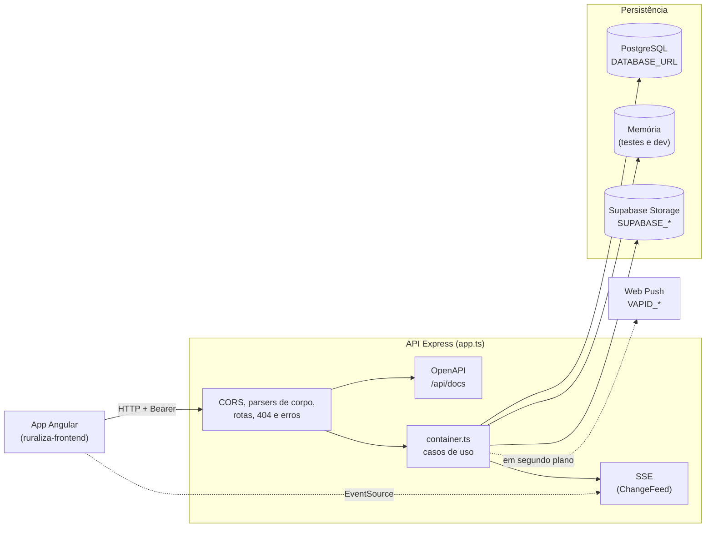
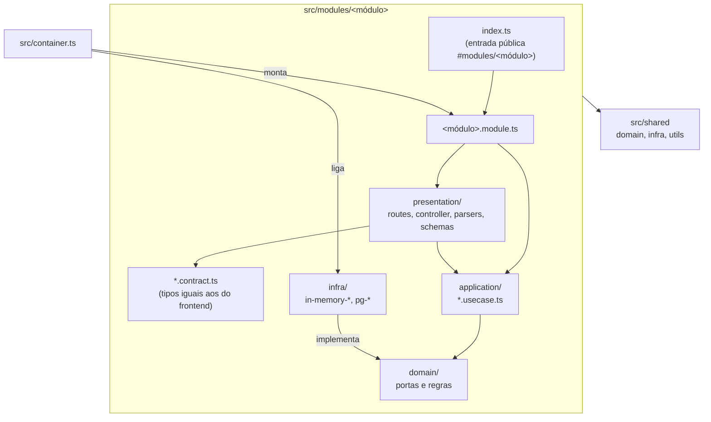
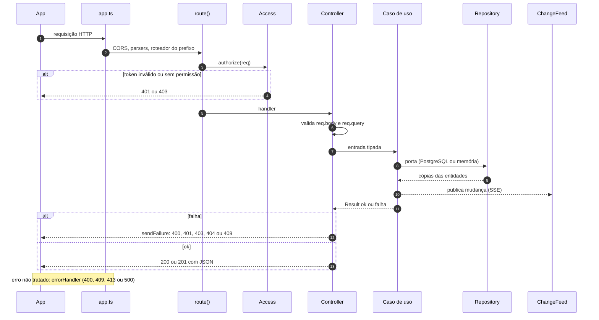
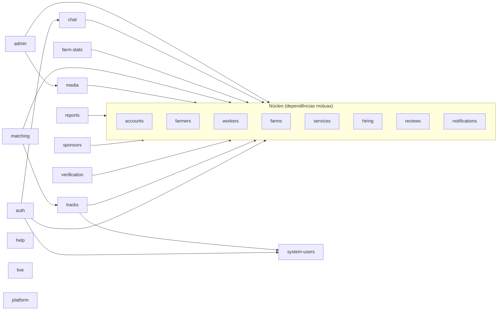

# Diagramas

Diagramas em Mermaid da arquitetura descrita em [architecture.md](architecture.md). Quando os dois divergirem, vale o código e depois o `architecture.md`; atualize os dois juntos.

## Visão geral

O app Angular fala só com a API. A persistência é escolhida na subida: PostgreSQL com `DATABASE_URL`, memória sem ela. Push e Supabase Storage são opcionais e ligados por variáveis de ambiente.

## Camadas de um módulo

`presentation -> application -> domain <- infra`. O caso de uso só conhece as portas; o container escolhe a implementação.

## Fluxo de uma requisição

## Dependências entre módulos

Imports `#modules/<módulo>` fora de testes. Quase todo módulo importa `auth` (as políticas de `Access`), então essas setas ficam de fora. Os módulos do núcleo se importam entre si em vários sentidos e aparecem agrupados; a seta para o grupo quer dizer que o módulo usa um ou mais deles.

`help`, `live`, `platform` e `system-users` não dependem de outro módulo além de `auth` (`platform` nem dele).
